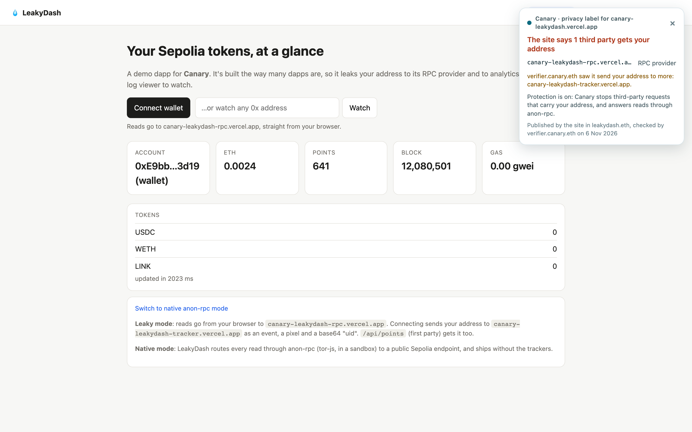
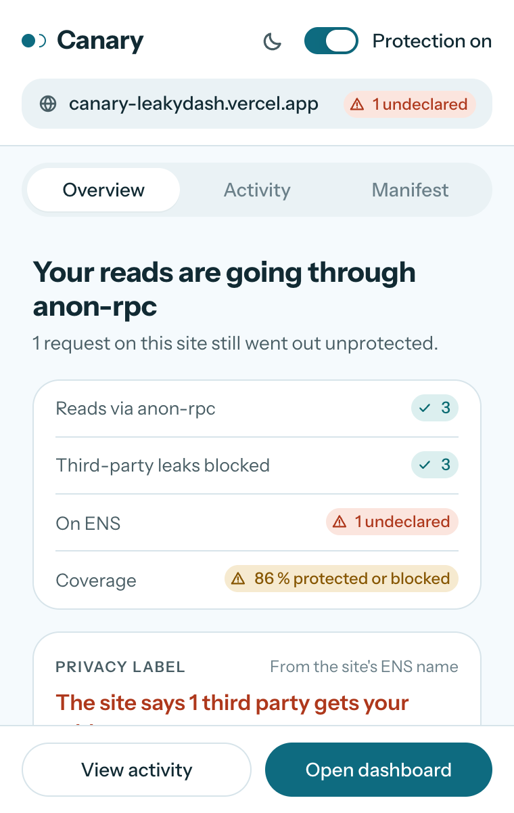
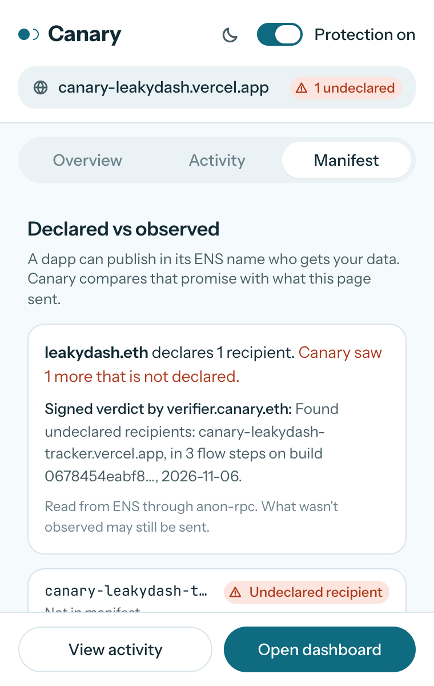
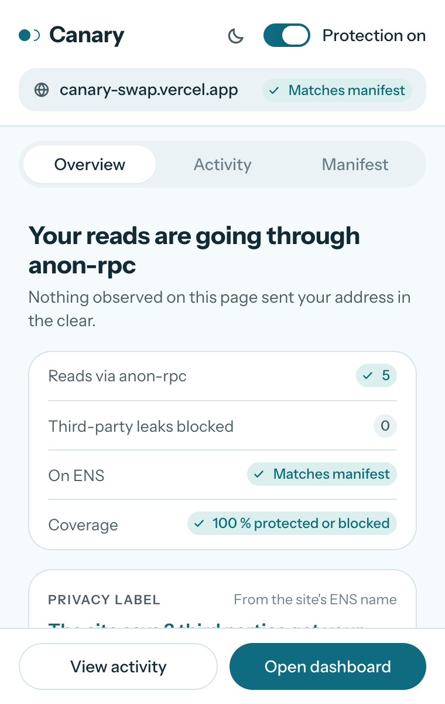
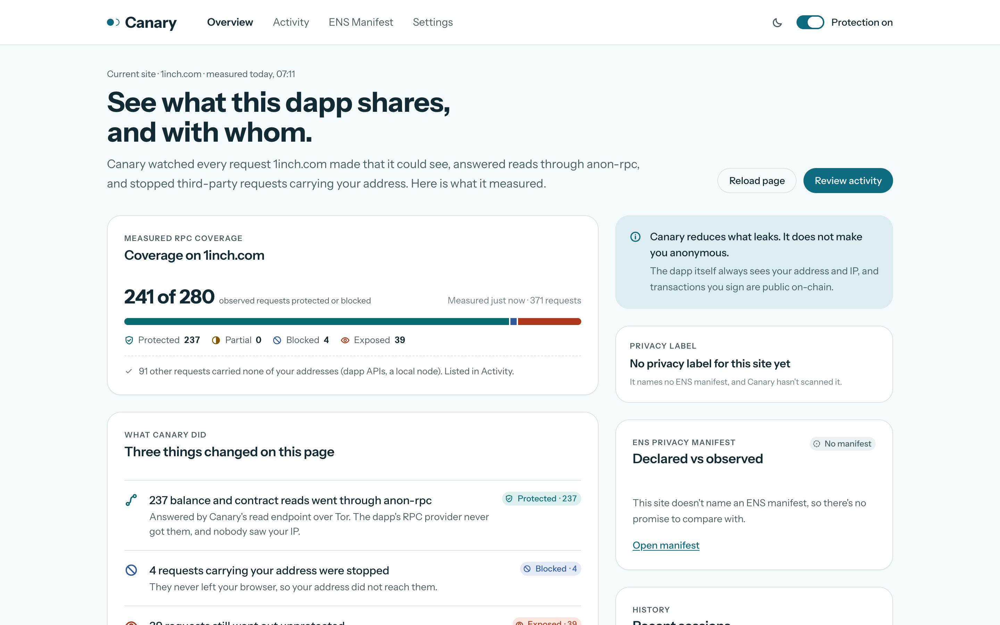
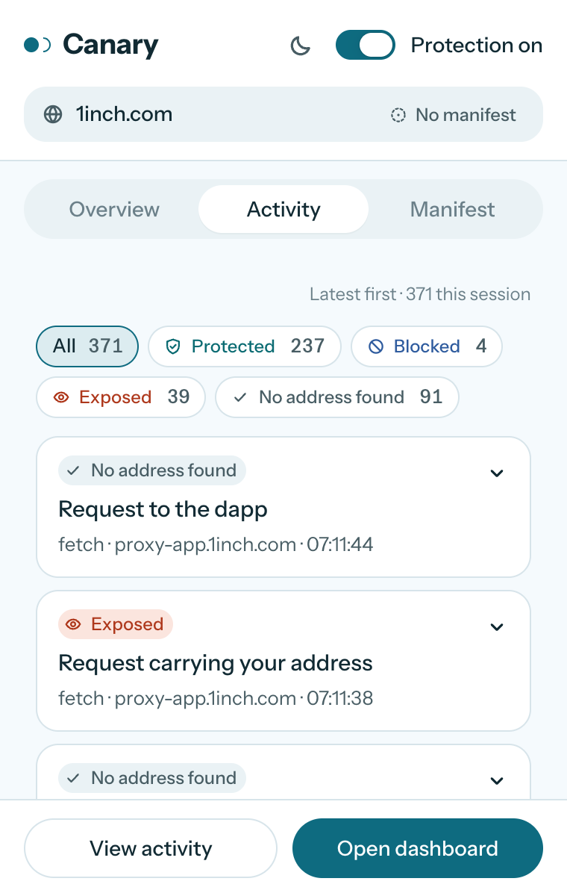
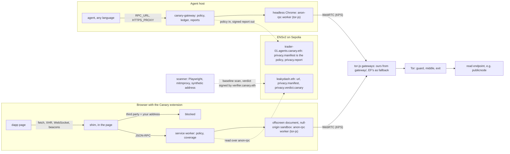

<p align="center">
  
</p>

<h1 align="center">Canary</h1>

<p align="center">
  <b>See what a dapp leaks before you connect, and stop it once you do. No dapp fork required.</b>
</p>

<p align="center">
  <a href="LICENSE"></a>
  <a href="https://ethglobal.com/events/mumbai"></a>
  <a href="https://github.com/ethereum/anon-rpc"></a>
  <a href="packages/ens/README.md#live-on-sepolia"></a>
  <a href="https://www.npmjs.com/package/@ayush_saklani/canary-agent"></a>
</p>

<p align="center">
  <a href="https://canary-leakydash.vercel.app"><b>Live demo (LeakyDash)</b></a> ·
  <a href="https://canary-swap.vercel.app"><b>Canary Swap</b></a> ·
  <a href="https://uixcanary.vercel.app"><b>Website</b></a> ·
  <a href="docs/performance.md"><b>Performance work</b></a> ·
  <a href="FEEDBACK.md"><b>Uniswap feedback</b></a>
</p>

Canary is a browser extension. It does three things:

- routes a dapp's RPC reads through the Ethereum Foundation's [anon-rpc](https://github.com/ethereum/anon-rpc), which is Tor built in the browser by tor-js;
- blocks third-party requests that carry your wallet address;
- shows, from ENS, who the dapp says gets your address and who actually does.

The same core protects autonomous agents through a local gateway and an SDK.

---

## Contents

- [The problem](#the-problem)
- [What Canary does](#what-canary-does)
- [Screenshots](#screenshots)
- [Results](#results)
- [How it works](#how-it-works)
- [Performance: making anon-rpc fast enough to use](#performance-making-anon-rpc-fast-enough-to-use)
- [Live on Sepolia](#live-on-sepolia)
- [Repository layout](#repository-layout)
- [Getting started](#getting-started)
- [Testing](#testing)
- [Security and privacy](#security-and-privacy)
- [Known limitations](#known-limitations)
- [Documentation](#documentation)
- [License](#license)

## The problem

Dapps built on wagmi/viem send your reads (`balanceOf(you)`, allowances, positions) straight from your browser to *their* RPC provider. That provider then holds your address next to your IP. Many dapps also send your address to analytics and trackers.

Your wallet's RPC settings never touch that traffic, so changing them doesn't help. A USENIX Security 2023 study found that 211 of 616 dapps leak the user's address to third parties.

## What Canary does

1. **Answers the dapp's own RPC reads through anon-rpc**, so the dapp's provider never sees them. Writes are never touched.
2. **Blocks third-party requests that carry your wallet address.** This covers fetch, XHR, WebSocket, beacons and pixels, with the address in any encoding: checksummed, lowercase, ABI-padded, URL-encoded or base64.
3. **Reports measured coverage**: what was protected, blocked, left exposed or not inspected. Each request gets a receipt of what each side saw with and without Canary.
4. **Shows the dapp's privacy label before you trust it with your address.**
   - The label comes from the dapp's own ENSv2 manifest.
   - Most dapps publish no manifest. For those, it comes from Canary's signed label on ENS (`app-aave-com.labels.canary.eth`).
   - The label appears in the popup, and on the page the moment the page gets your address.

The dapp itself can always see your address and IP. Canary protects you from third parties: RPC providers, analytics and trackers.

**Canary for agents** applies the same core to autonomous agents, whose reads reveal their strategy before they act. It has three parts:

- a local **gateway** that any agent, in any language, points its RPC URL and proxy at;
- a TypeScript **SDK** that also pseudonymizes wallet addresses in LLM prompts;
- an **ENSv2 name per agent**. Its `privacy.manifest` *is* the policy the gateway enforces, and signed egress reports are written to it by a key that can write nothing else.

## Screenshots

These are unedited captures of the extension on the live sites, taken in headless Chrome at 2× scale on 7 Nov 2026.

- **LeakyDash** used a Sepolia test wallet.
- **1inch and Aave** used a synthetic address that signs nothing.

**On the page:** the moment LeakyDash gets your address, Canary shows the site's privacy label from `leakydash.eth`. It also shows what `verifier.canary.eth` saw the site actually send.

<p align="center">
  
</p>

**The popup:**

<table>
  <tr>
    <td align="center" width="25%"></td>
    <td align="center" width="25%"></td>
    <td align="center" width="25%"></td>
    <td align="center" width="25%"></td>
  </tr>
  <tr>
    <td align="center">Reads through anon-rpc and leaks blocked, on LeakyDash</td>
    <td align="center">Declared vs observed: <code>leakydash.eth</code> and the verifier's signed verdict</td>
    <td align="center">app.aave.com publishes no manifest, so Canary's own label from ENS is shown</td>
    <td align="center">Canary Swap: matches its manifest, 100% coverage</td>
  </tr>
</table>

**The dashboard:** 1inch, live, with 237 reads through anon-rpc and 4 leaks blocked. The other 39 requests went out unprotected, and the dashboard reports them as exposed rather than hiding them.

<p align="center">
  
</p>

<p align="center">
  
  <br><sub>Activity on 1inch: every request, with what Canary did and why</sub>
</p>

## Results

| Measurement | Without Canary | With Canary |
|---|---|---|
| LeakyDash, live over tor-js: third parties that received the address | 2 | **0** |
| LeakyDash: RPC reads through anon-rpc (coverage) | 0% | **100%** |
| Five mainnet dapps (ENS, Uniswap, Aave, revoke.cash, Snapshot): third parties that received the address | 12 | **0** |
| Five mainnet dapps: RPC coverage | 0% | **100%** on four, 15% on Aave¹ |
| 1inch, live: reads across 14 chains | sent to its providers | **237 through anon-rpc, 0 held back** |
| Canary Swap stress run: 651 calls (10 swaps, 30 quotes, bursts to 11 RPC URLs) | n/a | **651/651 through anon-rpc**, 397/397 checked answers equal to a direct read, mean 1.37 s |
| Agents, live over tor-js on our gateways | n/a | **24/24 checks** |

¹ Aave sends most reads to its own RPC proxy in a non-JSON-RPC envelope, which Canary doesn't recognize.

Sources: [`test-artifacts/scans/RESULTS.md`](test-artifacts/scans/RESULTS.md), [`test-artifacts/scans/`](test-artifacts/scans/), and [`docs/test-log.md`](docs/test-log.md) §15, §19 and §22.

## How it works



- **One anon path for both hosts.** The extension and the agent gateway run the same anon-rpc worker (tor-js, hash-pinned on chain). It builds Tor circuits in the browser and reaches relays through a tor-js gateway over WebRTC. The read endpoint sees a Tor exit, not you.
- **Substitute, don't forward.** A standard read is answered from a read endpoint that accepts Tor, so the dapp's keyed provider never sees it. There are read endpoints for 71 chains, each checked over Tor. Each address gets its own isolation key, so reads about two addresses never share a circuit.
- **Fail closed.** If the anon path is down, protected reads fail with an error rather than going direct. A per-site opt-in allows direct requests instead.
- **Declared vs observed.**
  - A name's `privacy.manifest` says who should receive your address.
  - The scanner measures who does. The verifier signs what it found into `privacy.verdict.canary`, under a grant for that one key.
  - The extension checks the signature, that the verifier still holds its role, and the expiry.
  - For an agent, the manifest is enforced: the gateway blocks what it doesn't declare.
- **One core, two hosts.** `extension/` and `packages/` share `@ayush_saklani/canary-core`: the JSON-RPC classifier, address matching, coverage categories and the manifest schema.

**Who learns what:**

| Party | Learns | Doesn't learn |
|---|---|---|
| tor-js gateway | your IP, that you use Tor, traffic volume and timing | destinations, contents |
| Read endpoint | which addresses are queried | your IP, which dapp you use |
| The dapp's RPC provider | nothing from substituted reads | your reads, your address, your IP |
| Third-party trackers | nothing that carries your address | your address |
| The dapp itself | your address and IP, as always | — |

## Performance: making anon-rpc fast enough to use

When we started, a read over anon-rpc cost about 1.4 s, and EF's demo gateway took 18–43 s to boot. On 6 Nov it stopped completing boots at all. We measured where the time goes and cut it in three places:

- in Canary;
- in our own gateway infrastructure;
- in tor-js itself.

Full write-up: **[docs/performance.md](docs/performance.md)**.

**Shipped in the extension:**

| | Before | After |
|---|---|---|
| Browser launch → Tor ready | 18–43 s (EF's gateway); > 180 s once it degraded | **4.6–4.8 s** |
| A page firing 20 reads at once (median) | 3,237 ms, 73/80 answers OK | **1,680 ms, 80/80 OK** |
| 20 reads (bare worker) | 43–55 s one by one | **1.6–2.1 s** as one batch |
| Reads after a gateway dies | ~4.2 s each | **~0.8 s** |

How:

- **Batching:** calls for the same endpoint and the same address leave as one JSON-RPC batch. The batch is split in halves if an endpoint refuses its size.
- **Fewer requests:** identical calls in flight are deduplicated, and static calls are cached.
- **Pre-warm:** a newly connected wallet's circuit is opened before the dapp's first read, which saves ~0.9 s.
- **Packaged snapshot:** the build ships the Tor directory snapshot, so the directory is ready in 0.7 s instead of after a 12.7 s download.
- **Our own tor-js gateways** ([`gateway/`](gateway/)), with EF's as a fallback.
- **Hedge, then adopt:** a read with no answer after 3 s goes out again on a fresh circuit, and the winning circuit becomes that address's circuit.

**Patches for tor-js** ([`tor-js-patches/`](tor-js-patches/)): two of the bottlenecks are inside tor-js, so we patched it there and wrote the patches for upstream.

| Patch | Stock tor-js 0.4.4 | Patched |
|---|---|---|
| [0001](tor-js-patches/0001-http-keep-alive.patch) HTTP keep-alive per isolation key: warm read | p50 827 ms | **p50 234 ms** (~3.5×) |
| 0001: warm read through the whole extension | p50 653 ms | **p50 222 ms** |
| [0002](tor-js-patches/0002-gateway-liveness-check.patch) gateway liveness check: a gateway dies silently | 2 failed reads, 17–31 s to recover | **1 failed read, 10.5–14.0 s** |

The anon-rpc worker is pinned on chain by its hash, so the patches can't ship from Canary. They need a tor-js release and a newly registered worker. Both were reviewed for tor-js's edge cases before the final measurements:

- connections are never shared across isolation keys;
- a connection is reused only if its response ended exactly at its framed end, chunked trailers included;
- the idle pool is bounded and swept;
- a request is resent only if the connection closed before any response byte arrived (RFC 9112 §9.3.1), so a write is never sent twice.

**Bugs and issues we found:**

1. **tor-js sends `Connection: close` on every request** (`crates/tor-js-wasm/src/fetch.rs:382`). Every read pays for a new Tor stream, TCP and TLS: about three circuit round trips. This is the main reason a read costs ~1 s. Fixed by patch 0001.
2. **tor-js notices a silently dead gateway only when its WebRTC transport times out**, and marks it cooling only after a failure through it. That means 2 failed reads and up to 31 s of stall per dead gateway. Fixed by patch 0002.
3. **tor-js keeps giving an isolation key the circuit through a dead gateway**, so every later read stalls. Worked around in Canary: the hedge's circuit is adopted.
4. **EF's demo gateway can't reach Tor guards reliably** ("Unable to select a guard relay" after 177 s). From 6 Nov it stopped completing KPS handshakes. We run our own gateways from a pinned Docker build, with EF's as a fallback.
5. **anon-rpc's root e2e can't run on macOS:** `@infisical/quic-darwin-arm64@1.0.8` returns 404 on npm. We ran it in Docker instead.
6. **Many RPC providers refuse Tor.**
   - Tenderly and the official OP, Gnosis, zkSync and Taiko RPCs answer 403 to Tor exits.
   - Uniswap's RPC proxy answers 401.
   - dRPC's free plan rejects batches of more than 3 calls.

   Canary handles each of these.

Method, raw data and scripts: [docs/test-log.md §14](docs/test-log.md) and [`test-artifacts/latency/`](test-artifacts/latency/).

## Live on Sepolia

**[LeakyDash](https://canary-leakydash.vercel.app)** is a deliberately leaky token dashboard. Its RPC provider, tracker and backend show what they received at `/logs`. Its ENSv2 name `leakydash.eth` declares who should receive your address, and carries the verifier's signed verdict.

**[Canary Swap](https://canary-swap.vercel.app)** quotes Uniswap v4 straight from the Quoter over `eth_call`, with no address in the request; app.uniswap.org's quote sends your address as `swapper`. It swaps through the Universal Router on our ETH/CNRY v4 pool. `swap.canary.eth` carries a `matches` verdict.

ENSv2 names (12 in total; transactions in [`packages/ens/README.md`](packages/ens/README.md#live-on-sepolia)):

| Name | Holds |
|---|---|
| `leakydash.eth` | `url`, `privacy.manifest`, `privacy.verdict.canary`, on its own Permissioned Resolver |
| `canary.eth` | Canary's root, with a subname registry |
| `verifier.canary.eth` | the verifier's key, which signs verdicts under a one-key EAC grant (revocation is visible to readers) |
| `labels.canary.eth` | signed labels for dapps with no name of their own: Uniswap, Aave, ENS, revoke.cash, Snapshot |
| `swap.canary.eth` | Canary Swap's manifest and verdict |
| `agents.canary.eth`, `trader-01.agents.canary.eth` | an agent's policy (`privacy.manifest`) and the gateway's signed `privacy.report` |

## Repository layout

| Path | What |
|---|---|
| **Browser** | |
| [`extension/`](extension/) | The Canary MV3 extension: page shim, policy, anon-rpc pipeline, popup and dashboard, e2e test |
| [`scanner/`](scanner/) | Dapp scanner: who received a synthetic canary address, with and without Canary (Playwright + mitmproxy) |
| **Demo dapps** | |
| [`leakydash/`](leakydash/) | LeakyDash, the deliberately leaky demo dapp (local or Vercel) |
| [`swap/`](swap/) | Canary Swap: Uniswap v4 quotes with no address, swaps on Sepolia, pool script, live and stress tests |
| **Agents** | |
| [`packages/core/`](packages/core/) | `@ayush_saklani/canary-core`: JSON-RPC classifier, address matching, coverage, privacy manifest. Shared with the extension |
| [`packages/gateway/`](packages/gateway/) | `@ayush_saklani/canary-gateway`: anon-rpc in headless Chrome, JSON-RPC endpoint, HTTP(S) proxy, MITM CA, ledger, signed reports, `canary-gateway` CLI |
| [`packages/ens/`](packages/ens/) | `@ayush_saklani/canary-ens`: ENSv2 manifest, verdict and report records, one-key roles, revocation checks, `canary-ens` CLI |
| [`packages/agent/`](packages/agent/) | `@ayush_saklani/canary-agent`: in-process SDK for TypeScript agents (viem, ethers, fetch, LLM pseudonymizer) |
| [`examples/`](examples/) | [`viem-agent`](examples/viem-agent/) (with a leaky mode for before/after, and a Uniswap v4 swap) and [`python-agent`](examples/python-agent/) (no SDK, only `RPC_URL` and `HTTPS_PROXY`) |
| [`dashboard/`](dashboard/) | Web dashboard for Canary for agents (frontend only, placeholder data) |
| **Infrastructure** | |
| [`gateway/`](gateway/) | Dockerfile for running your own tor-js gateway (EF's `tor-js-gateway`, pinned commit) |
| [`tor-js-patches/`](tor-js-patches/) | Patches for upstream tor-js (keep-alive, gateway liveness), with tests and measurements |
| [`scripts/`](scripts/) | `set-gateways.mjs` (writes gateway addresses into every config) and `live-e2e.mjs` (agents, live over tor-js) |
| **Docs and evidence** | |
| [`docs/`](docs/) | Design notes, performance, agent SDK design, test log ([below](#documentation)); logo and screenshots in `docs/assets/` |
| [`test-artifacts/`](test-artifacts/) | Raw logs, scans and benchmark output behind every number in the docs |
| [`FEEDBACK.md`](FEEDBACK.md) | Uniswap developer feedback from building Canary Swap |
| [`archive/canary-spike/`](archive/canary-spike/) | The first proof of concept, superseded by `extension/` |

## Getting started

Requirements: Node 22+, Docker (for a tor-js gateway), and Chrome or Chromium.

### 1. Run a tor-js gateway

Browsers can't open the raw TCP connections Tor needs, so tor-js reaches Tor through a gateway. Run your own: it's one Docker container, and takes about 10 minutes to build the first time. Details are in [`gateway/README.md`](gateway/README.md).

```sh
docker build -t canary-gateway gateway/
docker run -d --name canary-gateway --restart unless-stopped -p 12298:12298/udp \
  -e ADVERTISE=127.0.0.1 -v canary-gateway:/data canary-gateway
docker logs canary-gateway            # prints this gateway's address: 127.0.0.1:12298:<certhash>
npm run gateways -- <that address>    # at the repo root: writes it into every config (--with-ef adds EF's as a fallback)
```

### 2. Build and load the extension

```sh
cd extension
npm install
npm run build        # → extension/dist
```

To load it:

1. In Chrome, open `chrome://extensions` and turn on Developer mode.
2. Click **Load unpacked** and pick `extension/dist`.

Use a separate Chrome profile, because Canary runs on every site. Tor is ready about 5 s after the browser starts.

To see it work, open [LeakyDash](https://canary-leakydash.vercel.app), connect, and compare `/logs` with and without the extension.

### 3. Canary for agents

The packages are on npm:

| Package | What |
|---|---|
| [`@ayush_saklani/canary-gateway`](https://www.npmjs.com/package/@ayush_saklani/canary-gateway) | the gateway and its `canary-gateway` CLI |
| [`@ayush_saklani/canary-agent`](https://www.npmjs.com/package/@ayush_saklani/canary-agent) | the TypeScript SDK |
| [`@ayush_saklani/canary-ens`](https://www.npmjs.com/package/@ayush_saklani/canary-ens) | ENSv2 records and the `canary-ens` CLI |
| [`@ayush_saklani/canary-core`](https://www.npmjs.com/package/@ayush_saklani/canary-core) | shared logic, installed with the others |

They need Node 20.11+ and Chrome: the gateway runs anon-rpc in headless Chrome.

```sh
npm install @ayush_saklani/canary-gateway @ayush_saklani/canary-agent viem
npx canary-gateway --config canary.config.json
```

For the config:

1. Start from [`examples/viem-agent/canary.config.json`](examples/viem-agent/canary.config.json) and its [`manifest.json`](examples/viem-agent/manifest.json).
2. List your tor-js gateway from step 1 under `network.workerConfig.gateways`.

Then, in the agent:

```ts
import { createCanary } from "@ayush_saklani/canary-agent";

const canary = await createCanary({ gateway: "http://127.0.0.1:18545", wallets: [account.address] });
const client = createPublicClient({ chain: sepolia, transport: canary.viemTransport() });
```

To run the example agent from this repo instead:

```sh
npm install && npm run build     # at the repo root: packages/core, ens, gateway, agent
cd examples/viem-agent
npm run gateway                  # terminal 1: tor-js boots in a few seconds on your own gateway
WALLET=0x… npm run agent         # terminal 2 (npm run agent:leaky runs the same agent without Canary)
```

- **Any language:**
  - Point the agent's RPC URL at `http://127.0.0.1:18545/<chainId>`, and its chain reads go through anon-rpc.
  - `HTTPS_PROXY=http://127.0.0.1:18080` adds per-host rules.
  - Without the local CA, HTTPS can only go direct or be blocked. With it (`canary-gateway ca`, then `"mitm": true`), `anon` hosts go through anon-rpc too.
- **TypeScript:** `createCanary()` from `@ayush_saklani/canary-agent` gives you:
  - a viem transport;
  - an ethers provider;
  - a policy-checked `fetch`;
  - `llmFetch`, which replaces wallet addresses with `WALLET_1` before a prompt leaves.
- **Policy:** the manifest comes from a local file (`examples/viem-agent/manifest.json`) or from the agent's ENSv2 name (`npm run gateway:ens`). Undeclared hosts are blocked by default.

Each package's README documents its API and config. The design and its rationale are in [docs/agent-sdk.md](docs/agent-sdk.md).

## Testing

All suites run offline against EF's passthrough reference worker, hash-verified as on chain, and mock ENSv2 contracts. Latest run, 7 Nov 2026:

| Suite | Command | Result |
|---|---|---|
| `@ayush_saklani/canary-core` | `npm test` at the root | 14/14 |
| `@ayush_saklani/canary-ens` | `npm test` at the root | 10/10 |
| `@ayush_saklani/canary-gateway` | `npm test` at the root | 42/42 |
| `@ayush_saklani/canary-agent` | `npm test` at the root | 13/13 |
| Extension unit tests (pipeline, ENS reader) | `npm run test:unit` in `extension/` | 23/23 |
| Extension e2e: real Chromium against a leaky fixture dapp on 9 fake domains ([log](extension/test/e2e.log)) | `CHROME_BIN=… npm test` in `extension/` | 53/53 checks |
| Extension wallet hold (account switching, listeners) | `CHROME_BIN=… npm test` in `extension/` | 17/17 checks |
| Canary Swap (v4 encodings) | `npm test` in `swap/` | 6/6 |
| LeakyDash (handler) | `npm test` in `leakydash/` | 4/4 |

Tests that need a browser use full Chromium or Chrome for Testing (`CHROME_BIN`); see [`extension/README.md`](extension/README.md). The live suites hit Sepolia over real Tor:

- `scripts/live-e2e.mjs`: agents, 24/24;
- `npm run test:ens-live` in `extension/`: ENS records;
- `swap/test/live.mjs` and `swap/test/stress.mjs`: Canary Swap.

## Security and privacy

Assessed against EF's CROPS criteria:

- **Censorship resistance.** Canary depends on a tor-js gateway and on read endpoints that accept Tor.
  - Gateways are a list: tor-js spreads clients across them and fails over on its own. Anyone can run one from [`gateway/`](gateway/).
  - If every gateway or the read endpoint goes away, Canary fails closed and says so.
  - Manifests, verdicts and reports are ENS records, readable over anon-rpc through any Ethereum RPC.
  - If our verifier stops, its verdicts expire and are shown as expired.
- **Open source.** MIT. Everything builds from this repo, including the scripts behind every measurement (`scanner/`, `test-artifacts/latency/`).
- **Privacy.**
  - We never run both a gateway and a read endpoint, so no single operator can match the two by timing.
  - Batching never mixes calls about different addresses.
  - Forwarded non-standard calls reveal the dapp to its provider, but not your IP.
  - Canary has no analytics or telemetry.
- **Security.**
  - Canary never holds keys or signs anything.
  - The anon-rpc worker is hash-pinned on chain and runs in a null-origin sandbox with none of the extension's permissions.
  - Verdicts are EIP-712 signed and checked against the verifier's ENS `addr` and its current role.
- **Agents.**
  - The gateway never touches wallet keys and refuses node-side signing.
  - Its report key can write one text record (`privacy.report`) and nothing else.
  - The MITM CA is opt-in and local, and its key never leaves `~/.canary/ca`.
  - Prompts reach LLM providers with wallet addresses pseudonymized.
  - Published reports are coarse (whole days, bucketed counts), so they don't reveal the agent's activity pattern.

## Known limitations

- **The dapp itself** still sees your address and IP. Canary protects you from third parties.
- **Gateway availability:** the extension's default build uses three of our gateways, made public through a Playit UDP tunnel from one team machine, with EF's as a fallback. Staying up for good needs a server with a public UDP port. Anyone can run a gateway from [`gateway/`](gateway/).
- **Read endpoints are trusted for correctness:** they could lie about responses. Verifying proofs is future work.
- **Coverage depends on recognizing RPC traffic:**
  - Reads in a non-JSON-RPC envelope (Aave's proxy) aren't inspected, and are counted as such.
  - Kaia and Blast have no read endpoint that works over Tor, so their reads are forwarded over anon-rpc.
- **The tor-js patches** need an upstream release before Canary can use them.
- **ENS reading:** only lowercase ASCII names are supported (no ENSIP-15 normalization). Names that need a CCIP-read lookup read as having no records.
- **Not built yet:** AgentKit, Eliza and LangChain adapters, and a backend for `dashboard/`.

## Documentation

| Document | Contents |
|---|---|
| [docs/performance.md](docs/performance.md) | Latency: where it goes, what we changed, the tor-js patches, and the bugs we found |
| [docs/design-notes.md](docs/design-notes.md) | Product, architecture, coverage model, build plan, risks, tracks |
| [docs/agent-sdk.md](docs/agent-sdk.md) | Canary for agents: gateway, SDK and ENSv2 agent names |
| [docs/test-log.md](docs/test-log.md) | Every test and measurement, with method and numbers |
| [extension/README.md](extension/README.md) | How the extension decides, its config, and its tests |
| [packages/ens/README.md](packages/ens/README.md) | ENS record formats, the verifier, labels, and the live Sepolia deployment |
| [swap/README.md](swap/README.md) | Canary Swap, and the Uniswap contracts and code that calls them |
| [FEEDBACK.md](FEEDBACK.md) | Uniswap developer feedback |

## License

[MIT](LICENSE). `extension/test/fixtures/passthrough-worker.js` (and its copy in `packages/gateway/test/fixtures/`) is the reference worker from [ethereum/anon-rpc](https://github.com/ethereum/anon-rpc) (MIT, © 2026 Ethereum Foundation). Only the tests use it.
